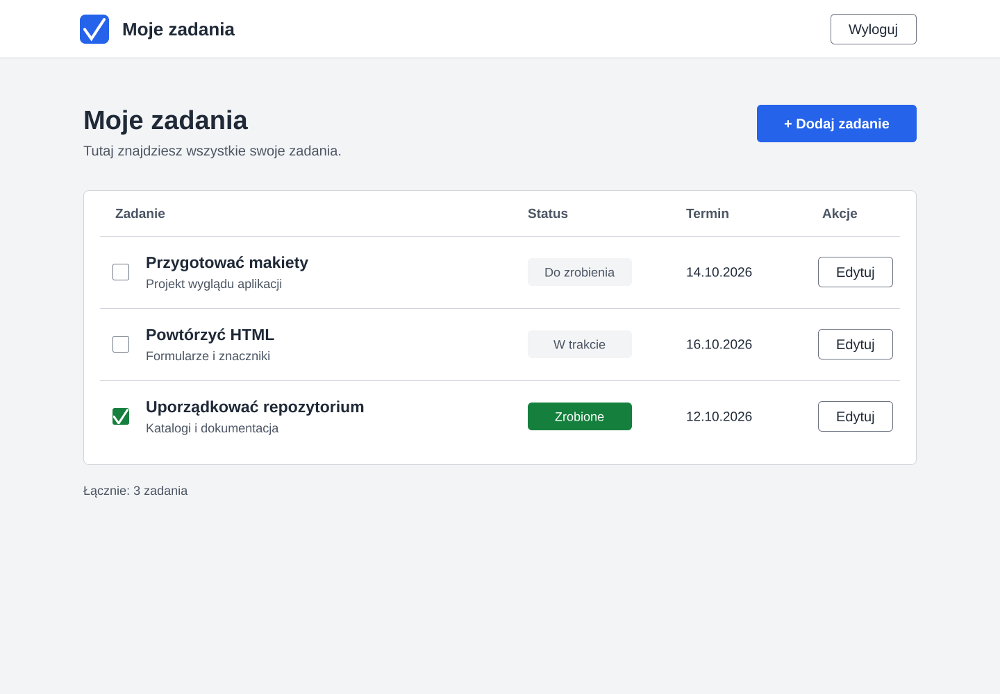
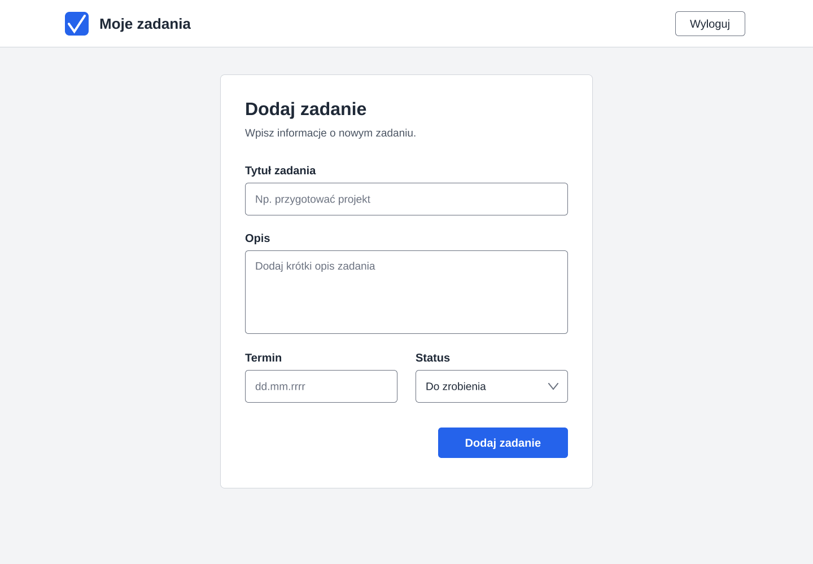
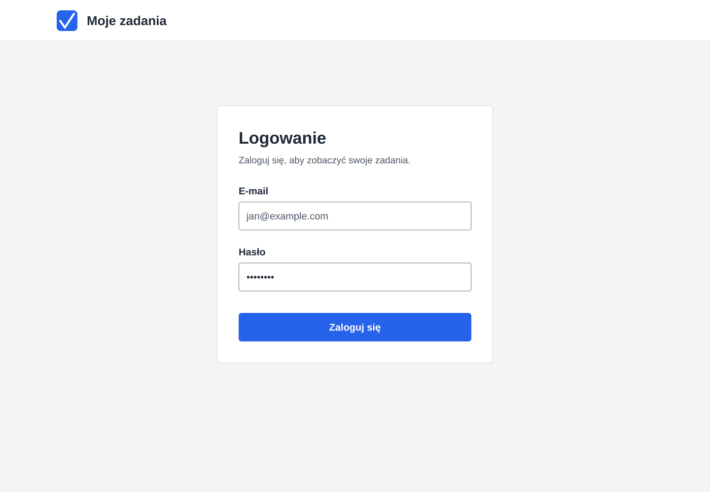
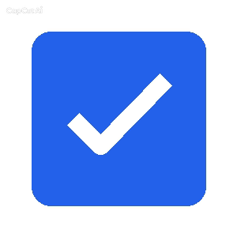

# Projekt wyglądu aplikacji

## Nazwa aplikacji

**Moje zadania**

Aplikacja służy do zapisywania zadań, edytowania ich i oznaczania jako wykonane.

## Paleta kolorów

| Element | Kolor HEX | Zastosowanie |
|---|---|---|
| Kolor główny | #2563EB | Główne przyciski i znak aplikacji |
| Kolor dodatkowy | #15803D | Oznaczenie wykonanych zadań |
| Tło | #F3F4F6 | Tło ekranów |
| Tekst | #1F2937 | Nagłówki, nazwy zadań i podpisy pól |
| Biały | #FFFFFF | Formularze, lista zadań i tekst na głównych przyciskach |

Jasne tło ułatwia czytanie. Niebieski wyróżnia główne przyciski.
Zielony oznacza wykonane zadania. Status jest opisany także tekstem,
dlatego jego znaczenie nie zależy tylko od koloru.

## Kontrast

| Kolor tekstu | Kolor tła | Kontrast |
|---|---|---|
| #1F2937 | #F3F4F6 | 13,34:1 |
| #1F2937 | #FFFFFF | 14,68:1 |
| #FFFFFF | #2563EB | 5,17:1 |
| #FFFFFF | #15803D | 5,02:1 |

Powyższe zestawienia spełniają próg WCAG AA dla zwykłego tekstu,
który wynosi co najmniej 4,5:1.

Narzędzie do sprawdzania:
[WebAIM Contrast Checker](https://webaim.org/resources/contrastchecker/).

## Czcionki

| Zastosowanie | Czcionka | Uzasadnienie |
|---|---|---|
| Nagłówki | Arial Bold | Pogrubione nagłówki są wyraźne i łatwo je zauważyć |
| Treść | Arial Regular | Prosty kształt liter ułatwia czytanie nazw zadań, opisów i podpisów pól |

Jedna rodzina czcionek nadaje ekranom spójny wygląd.
Pogrubienie pozwala odróżnić nagłówki od zwykłego tekstu.

## Makiety ekranów

### 1. Lista zadań

Ekran pokazuje nazwy zadań, krótkie opisy, statusy i terminy.

- Przycisk „Dodaj zadanie” otwiera formularz dodawania.
- Przycisk „Edytuj” otwiera formularz wybranego zadania.
- Pole zaznaczenia pozwala oznaczyć zadanie jako wykonane.
- Przycisk „Wyloguj” służy do wylogowania.

### 2. Formularz dodawania i edycji

Formularz zawiera pola: tytuł zadania, opis, termin i status.

- „Zapisz zadanie” zapisuje dane i wraca do listy.
- „Anuluj” wraca do listy bez zapisywania.
- Podczas edycji pola zawierają dane wybranego zadania,
  a nagłówek zmienia się na „Edytuj zadanie”.

### 3. Logowanie

Ekran zawiera pola e-mail i hasło oraz przycisk „Zaloguj się”.
Hasło jest ukryte. Po poprawnym logowaniu użytkownik
przechodzi do listy zadań.

## Logo

Logo przedstawia białą fajkę na niebieskim tle.
Znak nawiązuje do oznaczania wykonanych zadań
i pasuje do przeznaczenia aplikacji.

## Interfejs — uzupełnienie wymagań dnia 3

Dotychczasowe makiety są materiałem z etapu projektowania.
W bieżącej implementacji tablica jest podzielona na trzy kolumny:
„Do zrobienia”, „W trakcie” i „Wykonane”. Zachowuje powyższą paletę,
czcionkę Arial oraz niebieskie przyciski i znak aplikacji.

Formularz zawiera tytuł, opis i listę wyboru statusu.
Karta pokazuje tytuł i opis, a przy pustym opisie tekst „brak opisu”.
Po edycji statusu karta przechodzi do odpowiedniej kolumny.
Usuwanie wymaga potwierdzenia.

Na komputerze trzy kolumny są obok siebie; do 760 px są ustawione pionowo.
Dane są tworzone przez metody DOM i `textContent`, bez `innerHTML`.
